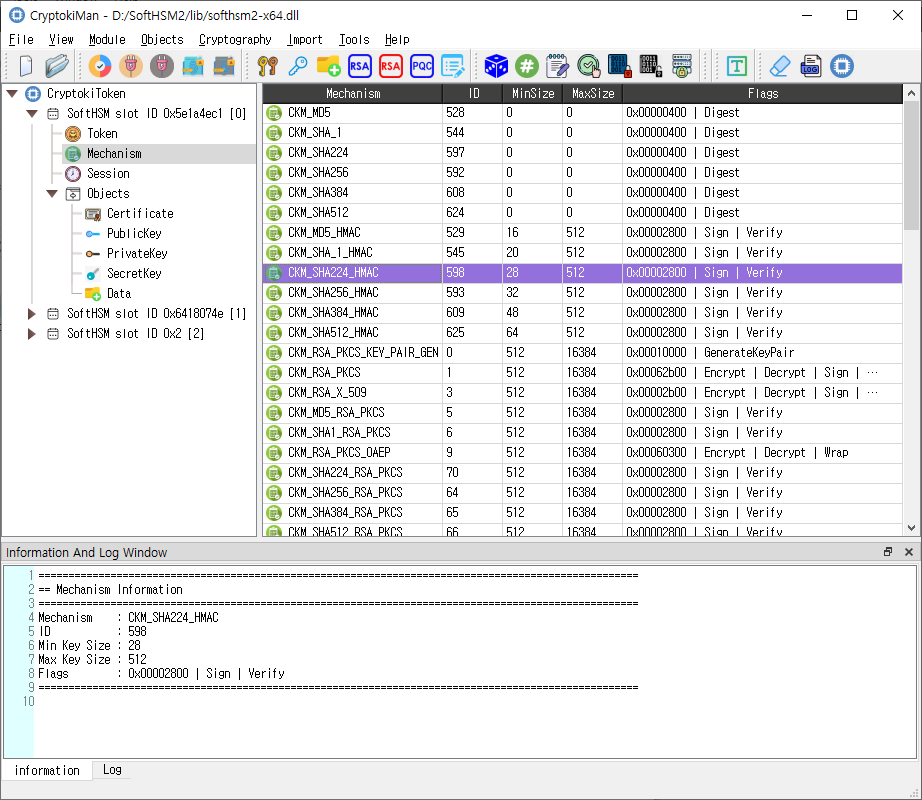

# CryptokiMan

**CryptokiMan** is a graphical manager and test utility for PKCS #11 (Cryptoki) libraries. It connects to a Cryptoki module supplied by a token or HSM vendor and provides a visual way to inspect slots, tokens, mechanisms, sessions, and cryptographic objects, then invoke supported PKCS #11 operations.

The information and download links in this guide are based on the supplied project index. The screenshots and feature descriptions reflect the CryptokiMan source and its user interface. Availability of an operation depends on the module, token, permissions, and license.

## What you can do

### Inspect a Cryptoki module and token

Load a vendor-provided PKCS #11 library and browse its module information, slots, tokens, mechanisms, and sessions. CryptokiMan presents properties in a field-and-value table and shows contextual information in the Information and Log panels.

### Manage sessions and authentication

Open read-only or read/write sessions, close one or all sessions for a token, log in as a user or security officer, and log out. PIN management tools provide token initialization, user-PIN initialization, and PIN changes where supported.

### Create and manage objects

The Objects menu supports key generation, key-pair generation, creation of data objects and key objects, object search, copy, attribute editing, and object destruction. The source includes dialogs for RSA, EC/ECDSA, EDDSA, DSA, and post-quantum cryptography (PQC) public and private key objects.

Objects are held and governed by the selected token. Whether an attribute can be changed, an object can be copied, or key material can be exported is subject to the module and token policy.

### Run cryptographic operations

CryptokiMan provides interfaces for random-number generation, message digests, signing, signature verification, encryption, and decryption. Operation dialogs allow a user to select a mechanism and key, enter parameters, and provide data directly or from files. Some operations support multi-part processing.

Additional tools include key wrapping and unwrapping, key derivation, operation-state handling, CSR creation, CAVP utilities, and an HSM management interface.

### Import certificates and keys

Import workflows are available for certificates, PKCS #12/PFX bundles, and supported private-key files. Import dialogs let the user configure attributes for the resulting certificate and key objects.

## Typical workflow

1. Install or locate the PKCS #11 library for the token or HSM you intend to use.
2. Start CryptokiMan and choose **File > Open...** to load that library. A library file can also be dragged into the main window.
3. Browse the navigation tree and select a slot or token to inspect its information and supported mechanisms.
4. Choose **Module > Open Session**. Select read/write access only when the operation requires it and the token allows it.
5. Log in when the operation requires authentication. Select the correct role and use the PIN assigned for that role.
6. Select an object category or use the relevant menu to run an operation. Review details, status, and errors in the Information and Log panels.
7. Close the session when finished. Unload the Cryptoki library before loading a different module.

Only one Cryptoki library can be loaded at a time. **Initialize Token** can erase existing token data; use it only when you intend to initialize that token.

## Main window

- **Navigation tree:** Shows the loaded library and its slots, tokens, mechanisms, sessions, and objects.
- **Details table:** Shows properties for the selected tree item or lists objects. Select an object row to inspect it; double-click or right-click for available object actions.
- **Information tab:** Displays information and details for the current selection.
- **Log tab:** Displays application and operation messages. The dock can be shown from **File > Show log tab**.
- **Menus and toolbars:** Provide File, Module, Objects, Cryptography, Import, Tools, and Help commands. The View menu can show or hide toolbar buttons when available.

## Compatibility and testing

CryptokiMan operates through the PKCS #11 library that you load. It does not replace that library or the token's policy. Mechanisms and operations shown by the application may be unsupported or restricted by a particular token.

The supplied project index says the application was tested with a library downloaded from [SoftHSM](https://www.opendnssec.org/softhsm/). SoftHSM provides a software token useful for development and testing; a vendor module may behave differently.

## Related dialog guides

The `md` folder contains English guides for the main window and individual dialogs, including session management, login, key generation, object management, cryptographic operations, imports, token tools, settings, and licensing. Each dialog guide includes its matching screenshot from the `images` folder.

