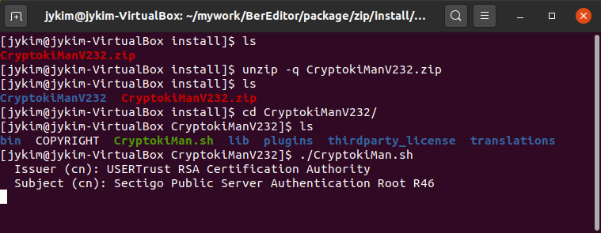

# CryptokiMan Installation on Linux

These steps follow the Linux installation screenshot and use the CryptokiMan 2.3.2 ZIP package.



*Extract the archive and start CryptokiMan from a terminal.*

## Download and extract

Download the [CryptokiMan 2.3.2 Linux package](https://jykim74.github.io/zip/CryptokiManV232.zip) and open a terminal in the directory containing the downloaded ZIP file. Then run:

```bash
unzip -q CryptokiManV232.zip
cd CryptokiManV232
```

Check that the extracted directory contains `CryptokiMan.sh`:

```bash
ls
```

## Start CryptokiMan

Run the launcher from the extracted directory:

```bash
./CryptokiMan.sh
```

The first launch may display certificate information and ask for input. The screenshot shows these values:

- **Issuer (CN):** USERTrust RSA Certification Authority
- **Subject (CN):** Sectigo Public Server Authentication Root R46

Review the prompt and certificate details before responding. Follow the exact instructions shown in your terminal; the screenshot does not show the final prompt or response.

## Troubleshooting

- If `unzip` cannot find the archive, change to the directory where the ZIP file was downloaded or use its full path.
- If `./CryptokiMan.sh` reports “Permission denied,” make the launcher executable and try again:

  ```bash
  chmod +x CryptokiMan.sh
  ./CryptokiMan.sh
  ```

- If startup reports a missing library, install the required runtime package for your Linux distribution and architecture, then run the launcher again.
