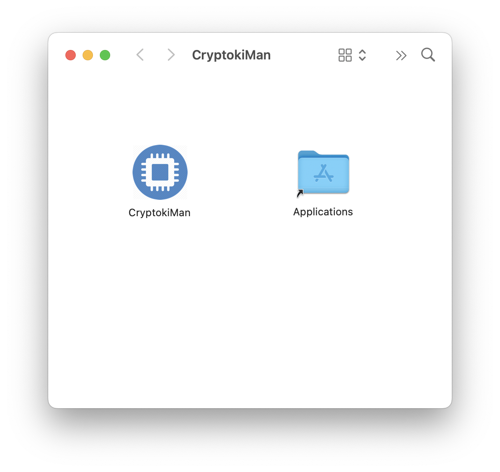

# Install BerEditor on macOS

1. Open the downloaded BerEditor disk image (`.dmg`). A window like the one below will appear.

   

2. Click and hold the **BerEditor** icon.
3. Drag it onto the **Applications** folder icon, then release the mouse button.
4. Wait for the copy to finish, then eject the BerEditor disk image.
5. Open **Applications** and double-click **BerEditor** to launch it.

If macOS asks you to confirm that you want to open the app, review the prompt and choose **Open**.
