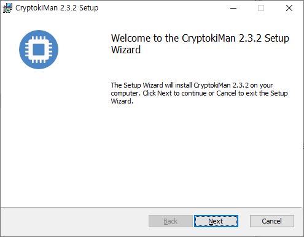
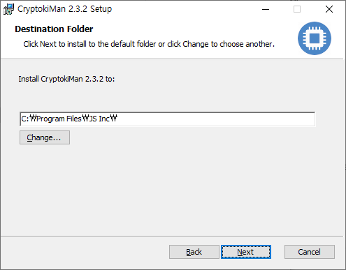
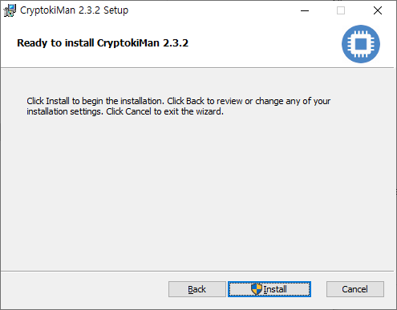
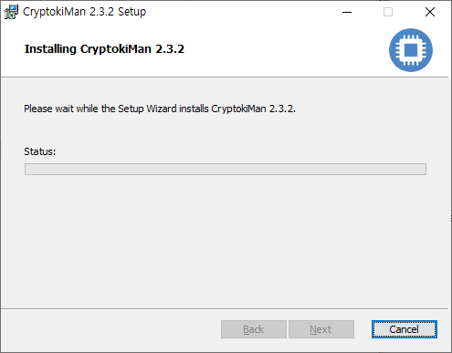
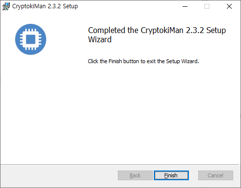

# CryptokiMan Installation on Windows

This guide follows the CryptokiMan 2.3.2 Windows Setup Wizard shown in the screenshots. Before starting, download and locate the CryptokiMan Windows installer (`.exe`).

## 1. Start the Setup Wizard

Double-click the downloaded installer. When the welcome page appears, select **Next** to continue.

*The welcome page starts the CryptokiMan 2.3.2 installation wizard.*

## 2. Choose the destination folder

The wizard displays its default installation folder. Keep it, or select **Change...** to choose another folder. Select **Next** when the destination is ready.

*Choose where the application files will be installed.*

## 3. Begin installation

Review the installation settings. Select **Back** if you need to change the destination. Select **Install** to begin copying the program files. If Windows displays a User Account Control prompt, review it and allow the installer to continue if appropriate.

*The wizard is ready to install CryptokiMan 2.3.2.*

## 4. Wait for setup to finish

Allow the Setup Wizard to complete the installation. Keep the wizard open while the progress indicator is active.

*The wizard shows installation progress.*

## 5. Finish

When the completion page appears, select **Finish** to close the Setup Wizard.

*The completion page confirms that the Setup Wizard has finished.*

## Start CryptokiMan

After setup, launch CryptokiMan from its Start menu entry or desktop shortcut if one was created. If no shortcut is available, open the installation folder and run the CryptokiMan application there.

## Troubleshooting

- If Windows asks for permission to make changes, verify that you started the CryptokiMan installer and review the prompt before continuing.
- If installation fails, run the installer again and choose a folder where your Windows account has permission to install applications.
- If the application does not start, try launching it from the installation folder and note any error message shown by Windows.
