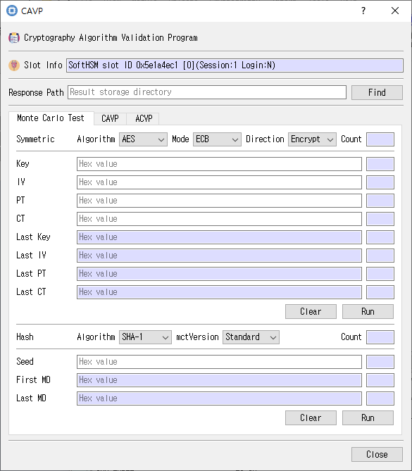

# CAVP Test Utility

This guide describes the dialog implemented by `cavp_dlg.cpp`, `cavp_dlg.h`, and `cavp_dlg.ui`.

## Purpose

Runs supported CAVP and ACVP test workflows using the selected Cryptoki slot, including Monte Carlo, request/response, and algorithm-specific tests.

## Fields and controls

| Control | Description |
|---|---|
| **Cryptography Algorithm Validation Program** | Input or information related to **Cryptography Algorithm Validation Program** for the current dialog operation. |
| **Slot Info** | Read-only information identifying the selected token slot. |
| **Response Path** | Input or information related to **Response Path** for the current dialog operation. |
| **Symmetric** | Input or information related to **Symmetric** for the current dialog operation. |
| **Mode** | Input or information related to **Mode** for the current dialog operation. |
| **Algorithm** | Algorithm family for the test or key operation. |
| **Count** | Input or information related to **Count** for the current dialog operation. |
| **Direction** | Input or information related to **Direction** for the current dialog operation. |
| **PT** | Input or information related to **PT** for the current dialog operation. |
| **Key** | Key value or selected key information. |
| **Last IV** | Input or information related to **Last IV** for the current dialog operation. |
| **IV** | Input or information related to **IV** for the current dialog operation. |
| **Last Key** | Input or information related to **Last Key** for the current dialog operation. |
| **Last PT** | Input or information related to **Last PT** for the current dialog operation. |
| **CT** | Input or information related to **CT** for the current dialog operation. |
| **Last CT** | Input or information related to **Last CT** for the current dialog operation. |
| **Run** | Input or information related to **Run** for the current dialog operation. |
| **mctVersion** | Input or information related to **mctVersion** for the current dialog operation. |
| **Hash** | Input or information related to **Hash** for the current dialog operation. |
| **First MD** | Input or information related to **First MD** for the current dialog operation. |
| **Seed** | Input or information related to **Seed** for the current dialog operation. |
| **Last MD** | Input or information related to **Last MD** for the current dialog operation. |
| **Type** | Input or information related to **Type** for the current dialog operation. |
| **Request File** | Input or information related to **Request File** for the current dialog operation. |
| **AE** | Input or information related to **AE** for the current dialog operation. |
| **MAC** | Input or information related to **MAC** for the current dialog operation. |
| **ECC** | Input or information related to **ECC** for the current dialog operation. |
| **Param** | Mechanism-specific parameters for the Cryptoki operation. |
| **RSA** | Input or information related to **RSA** for the current dialog operation. |
| **E** | Input or information related to **E** for the current dialog operation. |
| **DET RSA PrivateKey Path** | Input or information related to **DET RSA PrivateKey Path** for the current dialog operation. |
| **ACVP Request Response** | Input or information related to **ACVP Request Response** for the current dialog operation. |
| **Request JSON** | Input or information related to **Request JSON** for the current dialog operation. |
| **ACVP Hash LDT** | Input or information related to **ACVP Hash LDT** for the current dialog operation. |
| **Full Length Bits** | Input or information related to **Full Length Bits** for the current dialog operation. |
| **Content** | Input or information related to **Content** for the current dialog operation. |
| **MD** | Input or information related to **MD** for the current dialog operation. |
| **Progress** | Input or information related to **Progress** for the current dialog operation. |

### Object and operation attributes

These checkboxes configure the object template or operation. Their effect depends on token capabilities and permissions.

| Option | Meaning |
|---|---|
| **SkipLDT** | Sets the corresponding **SkipLDT** attribute or option for the operation. |
| **SetTcId** | Sets the corresponding **SetTcId** attribute or option for the operation. |
| **SetTgId** | Sets the corresponding **SetTgId** attribute or option for the operation. |

## Notes

Use the selected slot and session shown in **Slot Info**. Results depend on the PKCS #11 module, token support, object permissions, and entered values. CryptokiMan and/or the module reports operation errors.

## Source files

- `cavp_dlg.ui` defines the dialog layout and visible controls.
- `cavp_dlg.cpp` implements dialog behavior and Cryptoki operations.
- `cavp_dlg.h` declares the dialog class and interface.
