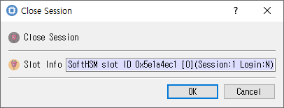

# Close Session Dialog

## Purpose

Closes the selected session, or closes all sessions for the selected token. The dialog title changes to **Close Session** or **Close All Sessions** to show which operation was requested.

## Displayed information

| Control | Description |
|---|---|
| **Slot Info** | Read-only information for the selected slot/token. |

## Buttons

| Button | Description |
|---|---|
| **OK** | Performs the selected close operation. On success, CryptokiMan clears its recorded session handle and login state. |
| **Cancel** | Closes the dialog without requesting the operation. |

If the Cryptoki call fails, the dialog displays an error and remains open. Closing a session ends operations associated with that session.
