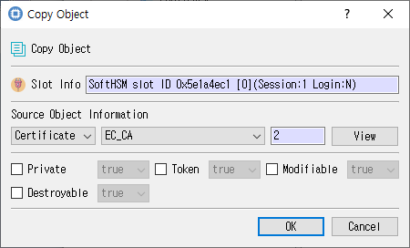

# Copy Object Dialog

## Purpose

Creates a copy of a selected token object. Review the source object, then set the attributes for the new copy.

## Fields and controls

| Control | Description |
|---|---|
| **Copy Object** | Input or information related to **Copy Object** for the current dialog operation. |
| **Slot Info** | Read-only information identifying the selected token slot. |
| **Source Object Information** | Input or information related to **Source Object Information** for the current dialog operation. |

### Object and operation attributes

These checkboxes configure the object template or operation. Their effect depends on token capabilities and permissions.

| Option | Meaning |
|---|---|
| **Private** | Marks an object private, subject to token login and policy. |
| **Token** | When checked, stores the object as a token object; otherwise it is session-scoped. |
| **Modifiable** | Allows object attributes to be modified. |
| **Destroyable** | Allows the object to be destroyed. |

## Typical use

Review the source object, set the desired attributes for the copy, and confirm the operation.

## Notes

Use the selected slot and session shown in **Slot Info**. Results depend on the PKCS #11 module, token support, object permissions, and entered values. CryptokiMan and/or the module reports operation errors.

## Source files

- `copy_object_dlg.ui` defines the dialog layout and visible controls.
- `copy_object_dlg.cpp` implements dialog behavior and Cryptoki operations.
- `copy_object_dlg.h` declares the dialog class and interface.
