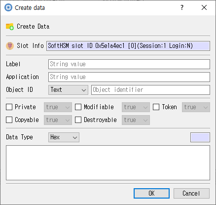

# Create Data Object Dialog

## Purpose

Creates a PKCS #11 data object on the selected token with application data and object attributes.

## Fields and controls

| Control | Description |
|---|---|
| **Create Data** | Input or information related to **Create Data** for the current dialog operation. |
| **Slot Info** | Read-only information identifying the selected token slot. |
| **Label** | Human-readable label assigned to an object or key. |
| **Application** | Application attribute for a PKCS #11 data object. |
| **Object ID** | PKCS #11 object identifier attribute. |
| **Data Type** | Application-defined type for a data object. |

### Object and operation attributes

These checkboxes configure the object template or operation. Their effect depends on token capabilities and permissions.

| Option | Meaning |
|---|---|
| **Private** | Marks an object private, subject to token login and policy. |
| **Modifiable** | Allows object attributes to be modified. |
| **Token** | When checked, stores the object as a token object; otherwise it is session-scoped. |
| **Copyable** | Allows the object to be copied. |
| **Destroyable** | Allows the object to be destroyed. |

## Typical use

Select the target slot, enter the data-object fields and flags, and submit the create action.

## Notes

Use the selected slot and session shown in **Slot Info**. Results depend on the PKCS #11 module, token support, object permissions, and entered values. CryptokiMan and/or the module reports operation errors.

## Source files

- `create_data_dlg.ui` defines the dialog layout and visible controls.
- `create_data_dlg.cpp` implements dialog behavior and Cryptoki operations.
- `create_data_dlg.h` declares the dialog class and interface.
