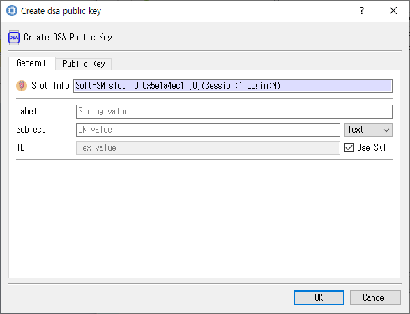

# Create DSA Public Key Dialog

*DSA public-key fields and usage attributes.*

## Purpose

Creates a DSA public-key object with public-key material, domain parameters, and public-key usage attributes.

## Fields and controls

| Control | Description |
|---|---|
| **Create DSA Public Key** | Input or information related to **Create DSA Public Key** for the current dialog operation. |
| **Slot Info** | Read-only information identifying the selected token slot. |
| **Subject** | Subject name associated with the key or certificate. |
| **ID** | Object identifier used to associate or locate objects. |
| **Label** | Human-readable label assigned to an object or key. |
| **Key Value** | Encoded key material. |
| **Key Length** | Requested or displayed key size, generally in bits. |
| **Gen Key** | Input or information related to **Gen Key** for the current dialog operation. |
| **Find Key** | Input or information related to **Find Key** for the current dialog operation. |
| **Subprime(Q)** | Input or information related to **Subprime(Q)** for the current dialog operation. |
| **Prime(P)** | Input or information related to **Prime(P)** for the current dialog operation. |
| **Base(G)** | Input or information related to **Base(G)** for the current dialog operation. |
| **Public** | Input or information related to **Public** for the current dialog operation. |

### Object and operation attributes

These checkboxes configure the object template or operation. Their effect depends on token capabilities and permissions.

| Option | Meaning |
|---|---|
| **Use SKI** | Sets the corresponding **Use SKI** attribute or option for the operation. |
| **Derive** | Permits deriving other keys. |
| **Encrypt** | Permits encryption with this key. |
| **Wrap** | Permits wrapping other keys. |
| **Private** | Marks an object private, subject to token login and policy. |
| **Trusted** | Marks a public key as trusted where supported. |
| **Verify** | Permits signature verification with this key. |
| **VerifyRecover** | Sets the corresponding **VerifyRecover** attribute or option for the operation. |
| **Modifiable** | Allows object attributes to be modified. |
| **Token** | When checked, stores the object as a token object; otherwise it is session-scoped. |
| **Destroyable** | Allows the object to be destroyed. |
| **Copyable** | Allows the object to be copied. |
| **StartDate** | Sets the corresponding **StartDate** attribute or option for the operation. |
| **EndDate** | Sets the corresponding **EndDate** attribute or option for the operation. |

## Notes

Use the selected slot and session shown in **Slot Info**. Results depend on the PKCS #11 module, token support, object permissions, and entered values. CryptokiMan and/or the module reports operation errors.
