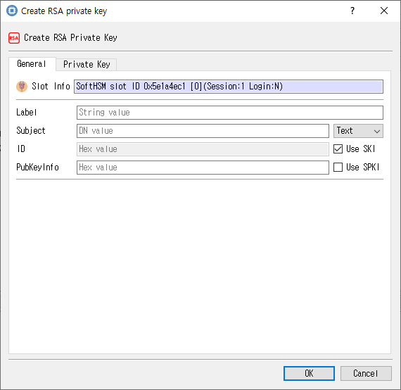

# Create RSA Private Key Dialog

## Purpose

Creates an RSA private-key object from its key components and private-key attributes.

## Fields and controls

| Control | Description |
|---|---|
| **Create RSA Private Key** | Input or information related to **Create RSA Private Key** for the current dialog operation. |
| **Slot Info** | Read-only information identifying the selected token slot. |
| **Subject** | Subject name associated with the key or certificate. |
| **Label** | Human-readable label assigned to an object or key. |
| **ID** | Object identifier used to associate or locate objects. |
| **PubKeyInfo** | Input or information related to **PubKeyInfo** for the current dialog operation. |
| **Key Length** | Requested or displayed key size, generally in bits. |
| **Key value** | Input or information related to **Key value** for the current dialog operation. |
| **E** | Input or information related to **E** for the current dialog operation. |
| **Gen Key** | Input or information related to **Gen Key** for the current dialog operation. |
| **Find Key** | Input or information related to **Find Key** for the current dialog operation. |
| **Public Exponent** | RSA public exponent. |
| **Private Exponent** | RSA private exponent. |
| **Exponent1** | Input or information related to **Exponent1** for the current dialog operation. |
| **Coefficient** | Input or information related to **Coefficient** for the current dialog operation. |
| **Prime1** | Input or information related to **Prime1** for the current dialog operation. |
| **Exponent2** | Input or information related to **Exponent2** for the current dialog operation. |
| **Prime2** | Input or information related to **Prime2** for the current dialog operation. |
| **Modules** | RSA modulus value. |

### Object and operation attributes

These checkboxes configure the object template or operation. Their effect depends on token capabilities and permissions.

| Option | Meaning |
|---|---|
| **Use SKI** | Sets the corresponding **Use SKI** attribute or option for the operation. |
| **Use SPKI** | Sets the corresponding **Use SPKI** attribute or option for the operation. |
| **Sensitive** | Marks private or secret key material as sensitive. |
| **Private** | Marks an object private, subject to token login and policy. |
| **Token** | When checked, stores the object as a token object; otherwise it is session-scoped. |
| **Extractable** | Allows key material to be extracted when permitted by token policy. |
| **Derive** | Permits deriving other keys. |
| **Modifiable** | Allows object attributes to be modified. |
| **Decrypt** | Permits decryption with this key. |
| **Sign** | Permits signing with this key. |
| **SignRecover** | Sets the corresponding **SignRecover** attribute or option for the operation. |
| **Unwrap** | Permits unwrapping keys. |
| **Copyable** | Allows the object to be copied. |
| **Destroyable** | Allows the object to be destroyed. |
| **StartDate** | Sets the corresponding **StartDate** attribute or option for the operation. |
| **EndDate** | Sets the corresponding **EndDate** attribute or option for the operation. |

## Notes

Use the selected slot and session shown in **Slot Info**. Results depend on the PKCS #11 module, token support, object permissions, and entered values. CryptokiMan and/or the module reports operation errors.

## Source files

- `create_rsa_pri_key_dlg.ui` defines the dialog layout and visible controls.
- `create_rsa_pri_key_dlg.cpp` implements dialog behavior and Cryptoki operations.
- `create_rsa_pri_key_dlg.h` declares the dialog class and interface.
