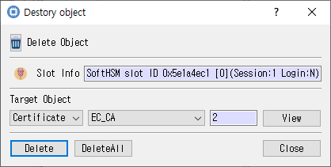

# Delete Object Dialog

*Controls for selecting and deleting token objects.*

## Purpose

Deletes one selected object or deletes all matching objects, depending on the action chosen.

## Fields and controls

| Control | Description |
|---|---|
| **Delete Object** | Input or information related to **Delete Object** for the current dialog operation. |
| **Slot Info** | Read-only information identifying the selected token slot. |
| **Target Object** | Input or information related to **Target Object** for the current dialog operation. |
| **Delete** | Input or information related to **Delete** for the current dialog operation. |
| **DeleteAll** | Input or information related to **DeleteAll** for the current dialog operation. |

## Notes

Use the selected slot and session shown in **Slot Info**. Results depend on the PKCS #11 module, token support, object permissions, and entered values. CryptokiMan and/or the module reports operation errors.
