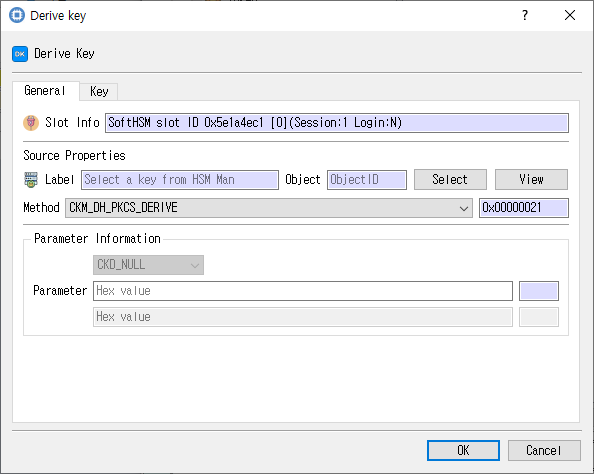

# Derive Key Dialog

This guide describes the dialog implemented by `derive_key_dlg.cpp`, `derive_key_dlg.h`, and `derive_key_dlg.ui`.

## Purpose

Derives a new key from a selected source key using a supported mechanism, parameters, and a destination key template.

## Fields and controls

| Control | Description |
|---|---|
| **Derive Key** | Input or information related to **Derive Key** for the current dialog operation. |
| **Slot Info** | Read-only information identifying the selected token slot. |
| **Source Properties** | Input or information related to **Source Properties** for the current dialog operation. |
| **Object** | Selected token object used as input or target. |
| **Label** | Human-readable label assigned to an object or key. |
| **Method** | Input or information related to **Method** for the current dialog operation. |
| **Param2** | Input or information related to **Param2** for the current dialog operation. |
| **Parameter Type** | Input or information related to **Parameter Type** for the current dialog operation. |
| **Param1** | Input or information related to **Param1** for the current dialog operation. |
| **Derived Key** | Input or information related to **Derived Key** for the current dialog operation. |
| **Class** | PKCS #11 object class for a template or search. |
| **KeySize** | Input or information related to **KeySize** for the current dialog operation. |
| **ID** | Object identifier used to associate or locate objects. |

### Object and operation attributes

These checkboxes configure the object template or operation. Their effect depends on token capabilities and permissions.

| Option | Meaning |
|---|---|
| **Use Random** | Requests random key material rather than manually supplied material, where supported. |
| **Private** | Marks an object private, subject to token login and policy. |
| **Sign** | Permits signing with this key. |
| **Derive** | Permits deriving other keys. |
| **Decrypt** | Permits decryption with this key. |
| **Unwrap** | Permits unwrapping keys. |
| **Sensitive** | Marks private or secret key material as sensitive. |
| **Verify** | Permits signature verification with this key. |
| **Token** | When checked, stores the object as a token object; otherwise it is session-scoped. |
| **Modifiable** | Allows object attributes to be modified. |
| **Encrypt** | Permits encryption with this key. |
| **Extractable** | Allows key material to be extracted when permitted by token policy. |
| **SignRecover** | Sets the corresponding **SignRecover** attribute or option for the operation. |
| **Wrap** | Permits wrapping other keys. |
| **VerifyRecover** | Sets the corresponding **VerifyRecover** attribute or option for the operation. |
| **Trusted** | Marks a public key as trusted where supported. |
| **Destroyable** | Allows the object to be destroyed. |
| **EndDate** | Sets the corresponding **EndDate** attribute or option for the operation. |
| **Copyable** | Allows the object to be copied. |
| **StartDate** | Sets the corresponding **StartDate** attribute or option for the operation. |

## Notes

Use the selected slot and session shown in **Slot Info**. Results depend on the PKCS #11 module, token support, object permissions, and entered values. CryptokiMan and/or the module reports operation errors.

## Source files

- `derive_key_dlg.ui` defines the dialog layout and visible controls.
- `derive_key_dlg.cpp` implements dialog behavior and Cryptoki operations.
- `derive_key_dlg.h` declares the dialog class and interface.
