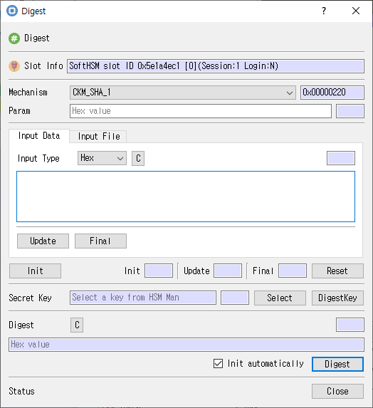

# Digest Dialog

## Purpose

Computes a message digest using a selected mechanism. Input can be supplied directly or read from a file.

## Fields and controls

| Control | Description |
|---|---|
| **Digest** | Input or information related to **Digest** for the current dialog operation. |
| **Slot Info** | Read-only information identifying the selected token slot. |
| **Mechanism** | Cryptographic mechanism for the operation. |
| **Param** | Mechanism-specific parameters for the Cryptoki operation. |
| **Input Type** | Input or information related to **Input Type** for the current dialog operation. |
| **C** | Input or information related to **C** for the current dialog operation. |
| **Final** | Input or information related to **Final** for the current dialog operation. |
| **Update** | Input or information related to **Update** for the current dialog operation. |
| **Src File Path** | Optional input file path. |
| **File Information** | Input or information related to **File Information** for the current dialog operation. |
| **Total File Size** | Input or information related to **Total File Size** for the current dialog operation. |
| **File Status** | Input or information related to **File Status** for the current dialog operation. |
| **Read File Size** | Input or information related to **Read File Size** for the current dialog operation. |
| **Run Status** | Input or information related to **Run Status** for the current dialog operation. |
| **Init** | Input or information related to **Init** for the current dialog operation. |
| **Reset** | Input or information related to **Reset** for the current dialog operation. |
| **DigestKey** | Input or information related to **DigestKey** for the current dialog operation. |
| **Secret Key** | Input or information related to **Secret Key** for the current dialog operation. |
| **Status** | Input or information related to **Status** for the current dialog operation. |

### Object and operation attributes

These checkboxes configure the object template or operation. Their effect depends on token capabilities and permissions.

| Option | Meaning |
|---|---|
| **RunThread** | Sets the corresponding **RunThread** attribute or option for the operation. |
| **Init automatically** | Sets the corresponding **Init automatically** attribute or option for the operation. |

## Typical use

Choose a digest mechanism, provide input directly or select a file, and run the digest. Use Init, Update, and Final when a multi-part operation is needed.

## Notes

Use the selected slot and session shown in **Slot Info**. Results depend on the PKCS #11 module, token support, object permissions, and entered values. CryptokiMan and/or the module reports operation errors.

## Source files

- `digest_dlg.ui` defines the dialog layout and visible controls.
- `digest_dlg.cpp` implements dialog behavior and Cryptoki operations.
- `digest_dlg.h` declares the dialog class and interface.
