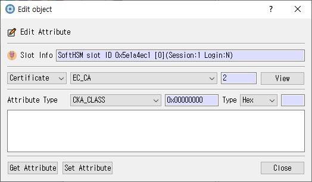

# Edit Attribute Dialog

*Controls for reading or changing one object attribute.*

## Purpose

Reads or changes an individual attribute on a selected object.

## Fields and controls

| Control | Description |
|---|---|
| **Edit Attribute** | Input or information related to **Edit Attribute** for the current dialog operation. |
| **Slot Info** | Read-only information identifying the selected token slot. |
| **Type** | Input or information related to **Type** for the current dialog operation. |
| **Attribute Type** | Input or information related to **Attribute Type** for the current dialog operation. |
| **Get Attribute** | Input or information related to **Get Attribute** for the current dialog operation. |
| **Set Attribute** | Input or information related to **Set Attribute** for the current dialog operation. |

## Notes

Use the selected slot and session shown in **Slot Info**. Results depend on the PKCS #11 module, token support, object permissions, and entered values. CryptokiMan and/or the module reports operation errors.
