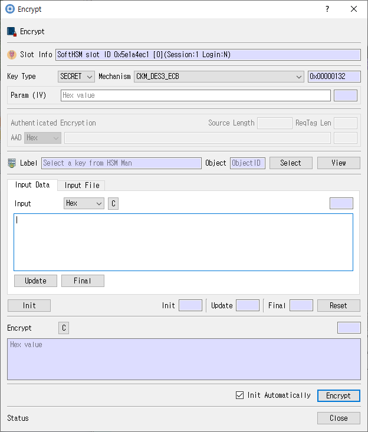

# Encrypt Dialog

This guide describes the dialog implemented by `encrypt_dlg.cpp`, `encrypt_dlg.h`, and `encrypt_dlg.ui`.

## Purpose

Encrypts input data with a selected key and mechanism. It supports operation parameters, direct input or source files, and output to a destination file.

## Fields and controls

| Control | Description |
|---|---|
| **Encrypt** | Permits encryption with this key. |
| **Slot Info** | Read-only information identifying the selected token slot. |
| **Key Type** | PKCS #11 key type or operation key category. |
| **Mechanism** | Cryptographic mechanism for the operation. |
| **Param (IV)** | Initialization vector or mechanism parameter. |
| **Param** | Mechanism-specific parameters for the Cryptoki operation. |
| **MGF1** | Input or information related to **MGF1** for the current dialog operation. |
| **CKZ_DATA_SPECIFIED** | Input or information related to **CKZ_DATA_SPECIFIED** for the current dialog operation. |
| **hashAlg** | Input or information related to **hashAlg** for the current dialog operation. |
| **Source** | Input or information related to **Source** for the current dialog operation. |
| **ReqTag Len** | Input or information related to **ReqTag Len** for the current dialog operation. |
| **Source Length** | Input or information related to **Source Length** for the current dialog operation. |
| **Authenticated Encryption** | Input or information related to **Authenticated Encryption** for the current dialog operation. |
| **AAD** | Input or information related to **AAD** for the current dialog operation. |
| **Label** | Human-readable label assigned to an object or key. |
| **Object** | Selected token object used as input or target. |
| **Input** | Input data for the selected operation. |
| **C** | Input or information related to **C** for the current dialog operation. |
| **Final** | Input or information related to **Final** for the current dialog operation. |
| **Update** | Input or information related to **Update** for the current dialog operation. |
| **Src File Path** | Optional input file path. |
| **File Information** | Input or information related to **File Information** for the current dialog operation. |
| **Total File Size** | Input or information related to **Total File Size** for the current dialog operation. |
| **File Status** | Input or information related to **File Status** for the current dialog operation. |
| **Read File Size** | Input or information related to **Read File Size** for the current dialog operation. |
| **Run Status** | Input or information related to **Run Status** for the current dialog operation. |
| **Dst File Path** | Destination path for operation output. |
| **Dst Information** | Input or information related to **Dst Information** for the current dialog operation. |
| **Init** | Input or information related to **Init** for the current dialog operation. |
| **Reset** | Input or information related to **Reset** for the current dialog operation. |
| **Status** | Input or information related to **Status** for the current dialog operation. |

### Object and operation attributes

These checkboxes configure the object template or operation. Their effect depends on token capabilities and permissions.

| Option | Meaning |
|---|---|
| **RunThread** | Sets the corresponding **RunThread** attribute or option for the operation. |
| **Init Automatically** | Sets the corresponding **Init Automatically** attribute or option for the operation. |

## Typical use

Select a key and mechanism, set required parameters, provide input directly or from a file, choose an output destination if needed, and start encryption.

## Notes

Use the selected slot and session shown in **Slot Info**. Results depend on the PKCS #11 module, token support, object permissions, and entered values. CryptokiMan and/or the module reports operation errors.

## Source files

- `encrypt_dlg.ui` defines the dialog layout and visible controls.
- `encrypt_dlg.cpp` implements dialog behavior and Cryptoki operations.
- `encrypt_dlg.h` declares the dialog class and interface.
