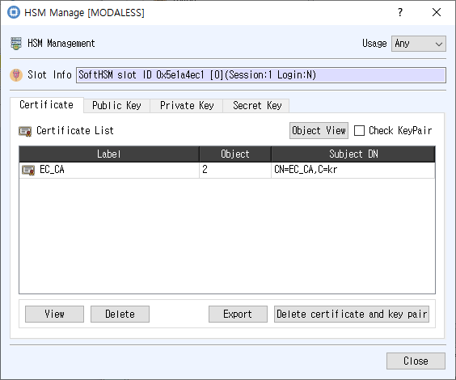

# HSM Management Dialog

*Lists of HSM certificates and keys with management controls.*

## Purpose

Provides a consolidated view of certificates and keys on the selected HSM, with object-specific view, export, delete, and cryptographic actions.

## Fields and controls

| Control | Description |
|---|---|
| **Usage** | Input or information related to **Usage** for the current dialog operation. |
| **HSM Management** | Input or information related to **HSM Management** for the current dialog operation. |
| **Slot Info** | Read-only information identifying the selected token slot. |
| **Object View** | Input or information related to **Object View** for the current dialog operation. |
| **Certificate List** | Input or information related to **Certificate List** for the current dialog operation. |
| **Export** | Input or information related to **Export** for the current dialog operation. |
| **Delete** | Input or information related to **Delete** for the current dialog operation. |
| **Delete certificate and key pair** | Input or information related to **Delete certificate and key pair** for the current dialog operation. |
| **Public Key List** | Input or information related to **Public Key List** for the current dialog operation. |
| **Verify** | Permits signature verification with this key. |
| **Encrypt** | Permits encryption with this key. |
| **Private Key List** | Input or information related to **Private Key List** for the current dialog operation. |
| **Sign** | Permits signing with this key. |
| **Decrypt** | Permits decryption with this key. |
| **Secret Key List** | Input or information related to **Secret Key List** for the current dialog operation. |

### Object and operation attributes

These checkboxes configure the object template or operation. Their effect depends on token capabilities and permissions.

| Option | Meaning |
|---|---|
| **Check KeyPair** | Sets the corresponding **Check KeyPair** attribute or option for the operation. |

## Notes

Use the selected slot and session shown in **Slot Info**. Results depend on the PKCS #11 module, token support, object permissions, and entered values. CryptokiMan and/or the module reports operation errors.
