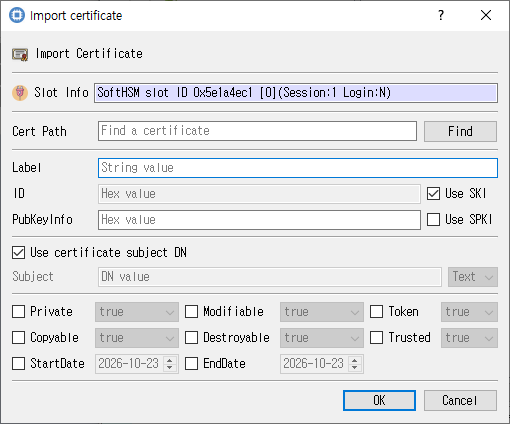

# Import Certificate Dialog

*Certificate file selection and imported-object attributes.*

## Purpose

Loads a certificate file and creates a certificate object on the selected token with the chosen attributes.

## Fields and controls

| Control | Description |
|---|---|
| **Import Certificate** | Input or information related to **Import Certificate** for the current dialog operation. |
| **Slot Info** | Read-only information identifying the selected token slot. |
| **Cert Path** | Path to the certificate file. |
| **ID** | Object identifier used to associate or locate objects. |
| **Label** | Human-readable label assigned to an object or key. |
| **PubKeyInfo** | Input or information related to **PubKeyInfo** for the current dialog operation. |
| **Subject** | Subject name associated with the key or certificate. |

### Object and operation attributes

These checkboxes configure the object template or operation. Their effect depends on token capabilities and permissions.

| Option | Meaning |
|---|---|
| **Use SKI** | Sets the corresponding **Use SKI** attribute or option for the operation. |
| **Use SPKI** | Sets the corresponding **Use SPKI** attribute or option for the operation. |
| **Use certificate subject DN** | Sets the corresponding **Use certificate subject DN** attribute or option for the operation. |
| **Private** | Marks an object private, subject to token login and policy. |
| **Modifiable** | Allows object attributes to be modified. |
| **Token** | When checked, stores the object as a token object; otherwise it is session-scoped. |
| **Copyable** | Allows the object to be copied. |
| **Destroyable** | Allows the object to be destroyed. |
| **Trusted** | Marks a public key as trusted where supported. |
| **StartDate** | Sets the corresponding **StartDate** attribute or option for the operation. |
| **EndDate** | Sets the corresponding **EndDate** attribute or option for the operation. |

## Typical use

Browse to a certificate file, review its subject and identifiers, set object attributes, and import it.

## Notes

Use the selected slot and session shown in **Slot Info**. Results depend on the PKCS #11 module, token support, object permissions, and entered values. CryptokiMan and/or the module reports operation errors.
