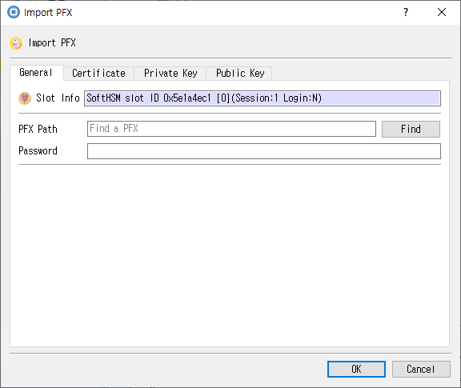

# Import PFX Dialog

## Purpose

Imports a PKCS #12/PFX file and configures the certificate, private-key, and public-key objects extracted from it.

## Fields and controls

| Control | Description |
|---|---|
| **Import PFX** | Input or information related to **Import PFX** for the current dialog operation. |
| **Slot Info** | Read-only information identifying the selected token slot. |
| **PFX Path** | Path to the PKCS #12/PFX file. |
| **Password** | Password used to access or decrypt the selected input file. |
| **Certificate Attributes** | Input or information related to **Certificate Attributes** for the current dialog operation. |
| **Label** | Human-readable label assigned to an object or key. |
| **ID** | Object identifier used to associate or locate objects. |
| **PubKeyInfo** | Input or information related to **PubKeyInfo** for the current dialog operation. |
| **Same Label** | Input or information related to **Same Label** for the current dialog operation. |
| **Subject** | Subject name associated with the key or certificate. |
| **Private Key Attributes** | Input or information related to **Private Key Attributes** for the current dialog operation. |
| **Public Key Attributes** | Input or information related to **Public Key Attributes** for the current dialog operation. |

### Object and operation attributes

These checkboxes configure the object template or operation. Their effect depends on token capabilities and permissions.

| Option | Meaning |
|---|---|
| **Use SKI** | Sets the corresponding **Use SKI** attribute or option for the operation. |
| **Use SPKI** | Sets the corresponding **Use SPKI** attribute or option for the operation. |
| **Use certificate subject DN** | Sets the corresponding **Use certificate subject DN** attribute or option for the operation. |
| **Private** | Marks an object private, subject to token login and policy. |
| **Modifiable** | Allows object attributes to be modified. |
| **Token** | When checked, stores the object as a token object; otherwise it is session-scoped. |
| **Trusted** | Marks a public key as trusted where supported. |
| **StartDate** | Sets the corresponding **StartDate** attribute or option for the operation. |
| **Copyable** | Allows the object to be copied. |
| **EndDate** | Sets the corresponding **EndDate** attribute or option for the operation. |
| **Destroyable** | Allows the object to be destroyed. |
| **Unwrap** | Permits unwrapping keys. |
| **Decrypt** | Permits decryption with this key. |
| **Sign** | Permits signing with this key. |
| **Derive** | Permits deriving other keys. |
| **SignRecover** | Sets the corresponding **SignRecover** attribute or option for the operation. |
| **Extractable** | Allows key material to be extracted when permitted by token policy. |
| **Sensitive** | Marks private or secret key material as sensitive. |
| **VerifyRecover** | Sets the corresponding **VerifyRecover** attribute or option for the operation. |
| **Verify** | Permits signature verification with this key. |
| **Encrypt** | Permits encryption with this key. |
| **Wrap** | Permits wrapping other keys. |

## Typical use

Select a PFX file and enter its password, configure certificate and key attributes, and import its contents.

## Notes

Use the selected slot and session shown in **Slot Info**. Results depend on the PKCS #11 module, token support, object permissions, and entered values. CryptokiMan and/or the module reports operation errors.

## Source files

- `import_pfx_dlg.ui` defines the dialog layout and visible controls.
- `import_pfx_dlg.cpp` implements dialog behavior and Cryptoki operations.
- `import_pfx_dlg.h` declares the dialog class and interface.
