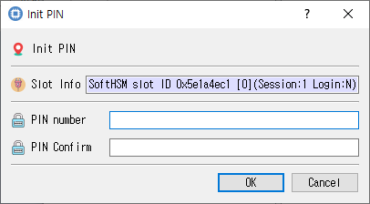

# Initialize User PIN Dialog

This guide describes the dialog implemented by `init_pin_dlg.cpp`, `init_pin_dlg.h`, and `init_pin_dlg.ui`.

## Purpose

Sets the initial user PIN on the selected token. Enter and confirm the PIN; security-officer authorization is normally required.

## Fields and controls

| Control | Description |
|---|---|
| **Init PIN** | Input or information related to **Init PIN** for the current dialog operation. |
| **Slot Info** | Read-only information identifying the selected token slot. |
| **PIN Confirm** | Confirmation entry; it should match the PIN. |
| **PIN number** | New PIN value to be set on the token. |

## Typical use

Enter the new user PIN and its confirmation, then submit the initialization.

## Notes

Use the selected slot and session shown in **Slot Info**. Results depend on the PKCS #11 module, token support, object permissions, and entered values. CryptokiMan and/or the module reports operation errors.

## Source files

- `init_pin_dlg.ui` defines the dialog layout and visible controls.
- `init_pin_dlg.cpp` implements dialog behavior and Cryptoki operations.
- `init_pin_dlg.h` declares the dialog class and interface.
