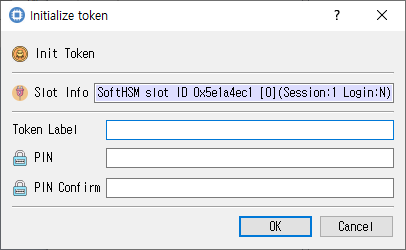

# Initialize Token Dialog

This guide describes the dialog implemented by `init_token_dlg.cpp`, `init_token_dlg.h`, and `init_token_dlg.ui`.

## Purpose

Initializes the selected token with a label and security-officer PIN. Initialization may erase existing token data.

## Fields and controls

| Control | Description |
|---|---|
| **Init Token** | Input or information related to **Init Token** for the current dialog operation. |
| **Slot Info** | Read-only information identifying the selected token slot. |
| **PIN Confirm** | Confirmation entry; it should match the PIN. |
| **PIN** | PIN for the selected token role. |
| **Token Label** | Input or information related to **Token Label** for the current dialog operation. |

## Typical use

Select the slot, enter and confirm the security-officer PIN, provide a token label, and initialize the token.

## Notes

Use the selected slot and session shown in **Slot Info**. Results depend on the PKCS #11 module, token support, object permissions, and entered values. CryptokiMan and/or the module reports operation errors.

## Source files

- `init_token_dlg.ui` defines the dialog layout and visible controls.
- `init_token_dlg.cpp` implements dialog behavior and Cryptoki operations.
- `init_token_dlg.h` declares the dialog class and interface.
