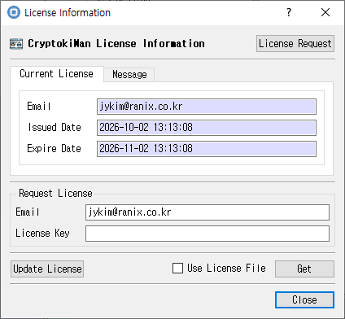

# License Information Dialog

*License status and license request or update controls.*

## Purpose

Displays CryptokiMan license status and provides controls for requesting, obtaining, updating, using, or removing a license.

## Fields and controls

| Control | Description |
|---|---|
| **License Request** | Input or information related to **License Request** for the current dialog operation. |
| **CryptokiMan License Information** | Input or information related to **CryptokiMan License Information** for the current dialog operation. |
| **Issued Date** | Input or information related to **Issued Date** for the current dialog operation. |
| **Email** | Input or information related to **Email** for the current dialog operation. |
| **Expire Date** | Input or information related to **Expire Date** for the current dialog operation. |
| **CryptokiMan** | Input or information related to **CryptokiMan** for the current dialog operation. |
| **License Key** | Input or information related to **License Key** for the current dialog operation. |
| **Free License** | Input or information related to **Free License** for the current dialog operation. |
| **Update License** | Input or information related to **Update License** for the current dialog operation. |
| **Get** | Input or information related to **Get** for the current dialog operation. |
| **Remove** | Input or information related to **Remove** for the current dialog operation. |

### Object and operation attributes

These checkboxes configure the object template or operation. Their effect depends on token capabilities and permissions.

| Option | Meaning |
|---|---|
| **Do stop showing this message for the time being** | Sets the corresponding **Do stop showing this message for the time being** attribute or option for the operation. |
| **Use License File** | Sets the corresponding **Use License File** attribute or option for the operation. |

## Notes

Use the selected slot and session shown in **Slot Info**. Results depend on the PKCS #11 module, token support, object permissions, and entered values. CryptokiMan and/or the module reports operation errors.
