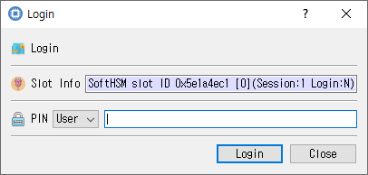

# Login Dialog

This guide describes the dialog implemented by `login_dlg.cpp`, `login_dlg.h`, and `login_dlg.ui`.

## Purpose

Authenticates to the selected token through an open session (`C_Login`). Authentication may be required to access private objects or perform protected operations.

## Fields

| Field | Description |
|---|---|
| **Slot Info** | Read-only information identifying the selected slot/token. |
| **Login type** | Select **SO** (Security Officer) or **User**. User is selected by default. |
| **PIN** | PIN for the selected role. Input is masked. |

## Buttons

| Button | Description |
|---|---|
| **Login** | Submits the selected role and PIN. On success, CryptokiMan records the logged-in state and closes the dialog. |
| **Close** | Closes without logging in. |

An open session is required, and the PIN cannot be empty. If authentication fails, an error is reported and the PIN field is cleared.
