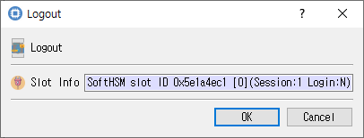

# Logout Dialog

This guide describes the dialog implemented by `logout_dlg.cpp`, `logout_dlg.h`, and `logout_dlg.ui`.

## Purpose

Ends the authenticated state for the selected session (`C_Logout`). Logging out does not close the session.

## Displayed information

| Control | Description |
|---|---|
| **Slot Info** | Read-only information identifying the selected slot/token. |

## Buttons

| Button | Description |
|---|---|
| **OK** | Requests logout. On success, CryptokiMan clears its recorded login state and closes the dialog. |
| **Cancel** | Closes without logging out. |

An open session is required. If the logout call fails, CryptokiMan reports the error and rejects the dialog.
