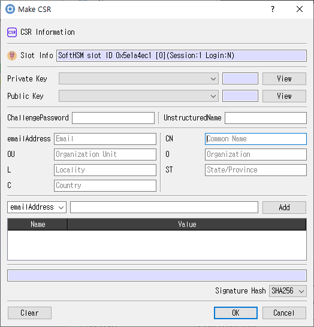

# Create CSR Dialog

This guide describes the dialog implemented by `make_csr_dlg.cpp`, `make_csr_dlg.h`, and `make_csr_dlg.ui`.

## Purpose

Builds a certificate signing request using a key pair and the supplied subject and request attributes.

## Fields and controls

| Control | Description |
|---|---|
| **CSR Information** | Input or information related to **CSR Information** for the current dialog operation. |
| **Slot Info** | Read-only information identifying the selected token slot. |
| **Public Key** | Input or information related to **Public Key** for the current dialog operation. |
| **Private Key** | Input or information related to **Private Key** for the current dialog operation. |
| **ChallengePassword** | Input or information related to **ChallengePassword** for the current dialog operation. |
| **UnstructuredName** | Input or information related to **UnstructuredName** for the current dialog operation. |
| **L** | Input or information related to **L** for the current dialog operation. |
| **CN** | Input or information related to **CN** for the current dialog operation. |
| **C** | Input or information related to **C** for the current dialog operation. |
| **ST** | Input or information related to **ST** for the current dialog operation. |
| **emailAddress** | Input or information related to **emailAddress** for the current dialog operation. |
| **O** | Input or information related to **O** for the current dialog operation. |
| **OU** | Input or information related to **OU** for the current dialog operation. |
| **Add** | Input or information related to **Add** for the current dialog operation. |
| **Signature Hash** | Input or information related to **Signature Hash** for the current dialog operation. |

## Typical use

Select the public and private keys, enter subject fields, choose a signature hash, and submit the CSR request.

## Notes

Use the selected slot and session shown in **Slot Info**. Results depend on the PKCS #11 module, token support, object permissions, and entered values. CryptokiMan and/or the module reports operation errors.

## Source files

- `make_csr_dlg.ui` defines the dialog layout and visible controls.
- `make_csr_dlg.cpp` implements dialog behavior and Cryptoki operations.
- `make_csr_dlg.h` declares the dialog class and interface.
