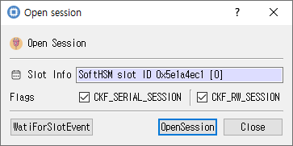

# Open Session Dialog

## Purpose

Opens a PKCS #11 session on the selected slot. A session is required for most token operations, including login and object management.

## Fields and options

| Control | Description |
|---|---|
| **Slot Info** | Read-only information for the selected slot. |
| **CKF_SERIAL_SESSION** | Requests a serial session. Checked by default. |
| **CKF_RW_SESSION** | Requests a read/write session. Checked by default; clear it to request read-only access. |

## Buttons

| Button | Description |
|---|---|
| **WaitForSlotEvent** | Calls the module's slot-event function and displays the return code. The UI currently spells this `WatiForSlotEvent`. |
| **OpenSession** | Opens the session using the selected slot and flags. On success the session handle is recorded and the dialog closes; on failure an error is shown. |
| **Close** | Closes the dialog without opening a session. |

## Typical use

Select a slot in the main window, open **Module > Open Session**, choose the session flags, and click **OpenSession**. The module determines the exact behavior of the slot-event call.
