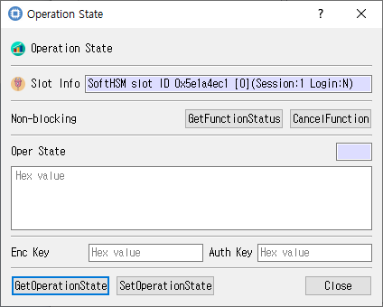

# Operation State Dialog

## Purpose

Gets or restores a cryptographic operation state, and provides controls for supported non-blocking operations.

## Fields and controls

| Control | Description |
|---|---|
| **Operation State** | Input or information related to **Operation State** for the current dialog operation. |
| **Slot Info** | Read-only information identifying the selected token slot. |
| **Non-blocking** | Input or information related to **Non-blocking** for the current dialog operation. |
| **GetFunctionStatus** | Input or information related to **GetFunctionStatus** for the current dialog operation. |
| **CancelFunction** | Input or information related to **CancelFunction** for the current dialog operation. |
| **Oper State** | Input or information related to **Oper State** for the current dialog operation. |
| **Enc Key** | Input or information related to **Enc Key** for the current dialog operation. |
| **Auth Key** | Input or information related to **Auth Key** for the current dialog operation. |
| **SetOperationState** | Input or information related to **SetOperationState** for the current dialog operation. |
| **GetOperationState** | Input or information related to **GetOperationState** for the current dialog operation. |

## Notes

Use the selected slot and session shown in **Slot Info**. Results depend on the PKCS #11 module, token support, object permissions, and entered values. CryptokiMan and/or the module reports operation errors.

## Source files

- `oper_state_dlg.ui` defines the dialog layout and visible controls.
- `oper_state_dlg.cpp` implements dialog behavior and Cryptoki operations.
- `oper_state_dlg.h` declares the dialog class and interface.
