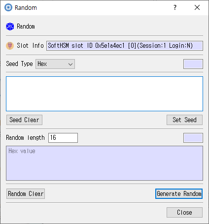

# Random Data Dialog

## Purpose

Generates random bytes or supplies seed data using the selected token session.

## Fields and controls

| Control | Description |
|---|---|
| **Random** | Input or information related to **Random** for the current dialog operation. |
| **Slot Info** | Read-only information identifying the selected token slot. |
| **Seed Type** | Input or information related to **Seed Type** for the current dialog operation. |
| **Seed Clear** | Input or information related to **Seed Clear** for the current dialog operation. |
| **Set Seed** | Input or information related to **Set Seed** for the current dialog operation. |
| **Random length** | Input or information related to **Random length** for the current dialog operation. |
| **Random Clear** | Input or information related to **Random Clear** for the current dialog operation. |
| **Generate Random** | Input or information related to **Generate Random** for the current dialog operation. |

## Typical use

Choose the seed or output length, enter or clear seed data as needed, and generate random bytes.

## Notes

Use the selected slot and session shown in **Slot Info**. Results depend on the PKCS #11 module, token support, object permissions, and entered values. CryptokiMan and/or the module reports operation errors.

## Source files

- `rand_dlg.ui` defines the dialog layout and visible controls.
- `rand_dlg.cpp` implements dialog behavior and Cryptoki operations.
- `rand_dlg.h` declares the dialog class and interface.
