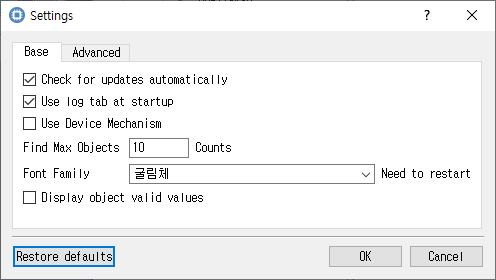

# Settings Dialog

*Application preferences for display, logging, and operations.*

## Purpose

Configures CryptokiMan preferences for logging, display, language, file reading, object searches, and update checks.

## Fields and controls

| Control | Description |
|---|---|
| **Find Max Objects** | Input or information related to **Find Max Objects** for the current dialog operation. |
| **Counts** | Input or information related to **Counts** for the current dialog operation. |
| **Font Family** | Input or information related to **Font Family** for the current dialog operation. |
| **Need to restart** | Input or information related to **Need to restart** for the current dialog operation. |
| **Language (need restart )** | Input or information related to **Language (need restart )** for the current dialog operation. |
| **Characters** | Input or information related to **Characters** for the current dialog operation. |
| **Use fixed hex area** | Input or information related to **Use fixed hex area** for the current dialog operation. |
| **Log Level** | Input or information related to **Log Level** for the current dialog operation. |
| **The size of the file to be read at one time** | Input or information related to **The size of the file to be read at one time** for the current dialog operation. |
| **File Read Size** | Input or information related to **File Read Size** for the current dialog operation. |
| **Restore defaults** | Input or information related to **Restore defaults** for the current dialog operation. |

### Object and operation attributes

These checkboxes configure the object template or operation. Their effect depends on token capabilities and permissions.

| Option | Meaning |
|---|---|
| **Check for updates automatically** | Sets the corresponding **Check for updates automatically** attribute or option for the operation. |
| **Use log tab at startup** | Sets the corresponding **Use log tab at startup** attribute or option for the operation. |
| **Use Device Mechanism** | Sets the corresponding **Use Device Mechanism** attribute or option for the operation. |
| **Display object valid values** | Sets the corresponding **Display object valid values** attribute or option for the operation. |

## Notes

Use the selected slot and session shown in **Slot Info**. Results depend on the PKCS #11 module, token support, object permissions, and entered values. CryptokiMan and/or the module reports operation errors.
