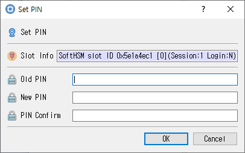

# Change PIN Dialog

*Fields for entering the current PIN and confirming a new PIN.*

## Purpose

Changes a token PIN by supplying the current PIN and confirming a new PIN.

## Fields and controls

| Control | Description |
|---|---|
| **Set PIN** | Input or information related to **Set PIN** for the current dialog operation. |
| **Slot Info** | Read-only information identifying the selected token slot. |
| **New PIN** | Input or information related to **New PIN** for the current dialog operation. |
| **Old PIN** | Input or information related to **Old PIN** for the current dialog operation. |
| **PIN Confirm** | Confirmation entry; it should match the PIN. |

## Typical use

Enter the current PIN, enter the new PIN twice, and submit the change.

## Notes

Use the selected slot and session shown in **Slot Info**. Results depend on the PKCS #11 module, token support, object permissions, and entered values. CryptokiMan and/or the module reports operation errors.
