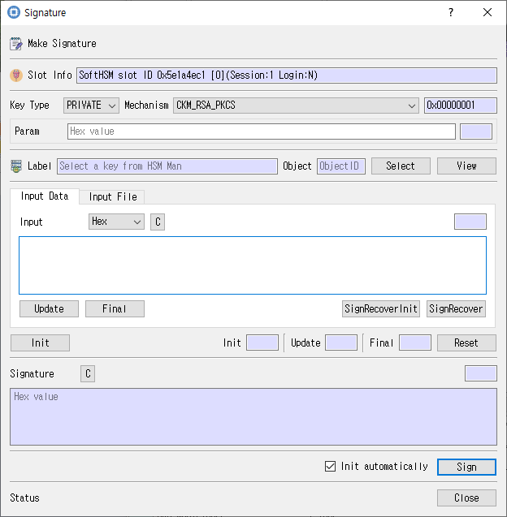

# Sign Data Dialog

This guide describes the dialog implemented by `sign_dlg.cpp`, `sign_dlg.h`, and `sign_dlg.ui`.

## Purpose

Signs data with a selected private key and mechanism. Input can be entered directly or read from a file; multi-part operations are supported.

## Fields and controls

| Control | Description |
|---|---|
| **Make Signature** | Input or information related to **Make Signature** for the current dialog operation. |
| **Slot Info** | Read-only information identifying the selected token slot. |
| **Key Type** | PKCS #11 key type or operation key category. |
| **Mechanism** | Cryptographic mechanism for the operation. |
| **Param** | Mechanism-specific parameters for the Cryptoki operation. |
| **Len** | Input or information related to **Len** for the current dialog operation. |
| **mgf** | Input or information related to **mgf** for the current dialog operation. |
| **HashAlg** | Input or information related to **HashAlg** for the current dialog operation. |
| **Label** | Human-readable label assigned to an object or key. |
| **Object** | Selected token object used as input or target. |
| **C** | Input or information related to **C** for the current dialog operation. |
| **Input** | Input data for the selected operation. |
| **Update** | Input or information related to **Update** for the current dialog operation. |
| **SignRecoverInit** | Input or information related to **SignRecoverInit** for the current dialog operation. |
| **SignRecover** | Input or information related to **SignRecover** for the current dialog operation. |
| **Final** | Input or information related to **Final** for the current dialog operation. |
| **Src File Path** | Optional input file path. |
| **File Information** | Input or information related to **File Information** for the current dialog operation. |
| **File Status** | Input or information related to **File Status** for the current dialog operation. |
| **Total File Size** | Input or information related to **Total File Size** for the current dialog operation. |
| **Read File Size** | Input or information related to **Read File Size** for the current dialog operation. |
| **Run Status** | Input or information related to **Run Status** for the current dialog operation. |
| **Reset** | Input or information related to **Reset** for the current dialog operation. |
| **Init** | Input or information related to **Init** for the current dialog operation. |
| **Signature** | Input or information related to **Signature** for the current dialog operation. |
| **Sign** | Permits signing with this key. |
| **Status** | Input or information related to **Status** for the current dialog operation. |

### Object and operation attributes

These checkboxes configure the object template or operation. Their effect depends on token capabilities and permissions.

| Option | Meaning |
|---|---|
| **RunThread** | Sets the corresponding **RunThread** attribute or option for the operation. |
| **Init automatically** | Sets the corresponding **Init automatically** attribute or option for the operation. |

## Typical use

Select a private key and signing mechanism, provide input or a file, configure parameters, and run Sign or the multi-part controls.

## Notes

Use the selected slot and session shown in **Slot Info**. Results depend on the PKCS #11 module, token support, object permissions, and entered values. CryptokiMan and/or the module reports operation errors.

## Source files

- `sign_dlg.ui` defines the dialog layout and visible controls.
- `sign_dlg.cpp` implements dialog behavior and Cryptoki operations.
- `sign_dlg.h` declares the dialog class and interface.
