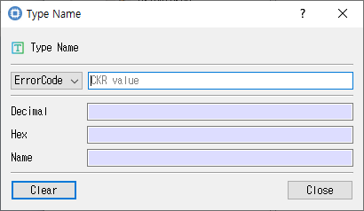

# Type Name Utility

This guide describes the dialog implemented by `type_name_dlg.cpp`, `type_name_dlg.h`, and `type_name_dlg.ui`.

## Purpose

Converts between a PKCS #11 type name and its decimal or hexadecimal representation.

## Fields and controls

| Control | Description |
|---|---|
| **Type Name** | Input or information related to **Type Name** for the current dialog operation. |
| **Name** | Input or information related to **Name** for the current dialog operation. |
| **Decimal** | Input or information related to **Decimal** for the current dialog operation. |
| **Hex** | Input or information related to **Hex** for the current dialog operation. |

## Typical use

Enter or select a type name and read its decimal and hexadecimal values; use Clear to reset the fields.

## Notes

Use the selected slot and session shown in **Slot Info**. Results depend on the PKCS #11 module, token support, object permissions, and entered values. CryptokiMan and/or the module reports operation errors.

## Source files

- `type_name_dlg.ui` defines the dialog layout and visible controls.
- `type_name_dlg.cpp` implements dialog behavior and Cryptoki operations.
- `type_name_dlg.h` declares the dialog class and interface.
