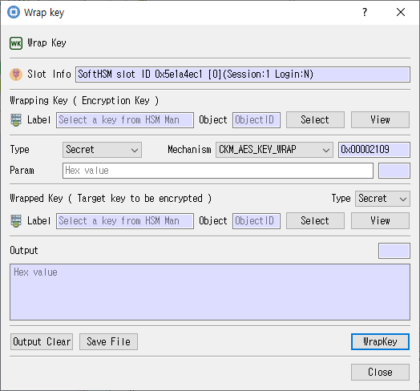

# Wrap Key Dialog

This guide describes the dialog implemented by `wrap_key_dlg.cpp`, `wrap_key_dlg.h`, and `wrap_key_dlg.ui`.

## Purpose

Wraps a target key in encrypted form using a selected wrapping key and mechanism.

## Fields and controls

| Control | Description |
|---|---|
| **Wrap Key** | Input or information related to **Wrap Key** for the current dialog operation. |
| **Slot Info** | Read-only information identifying the selected token slot. |
| **Wrapping Key ( Encryption Key )** | Input or information related to **Wrapping Key ( Encryption Key )** for the current dialog operation. |
| **Object** | Selected token object used as input or target. |
| **Label** | Human-readable label assigned to an object or key. |
| **Mechanism** | Cryptographic mechanism for the operation. |
| **Type** | Input or information related to **Type** for the current dialog operation. |
| **Param** | Mechanism-specific parameters for the Cryptoki operation. |
| **Wrapped Key ( Target key to be encrypted )** | Input or information related to **Wrapped Key ( Target key to be encrypted )** for the current dialog operation. |
| **Output** | Operation output or wrapped-key value. |
| **Output Clear** | Input or information related to **Output Clear** for the current dialog operation. |
| **Save File** | Input or information related to **Save File** for the current dialog operation. |
| **WrapKey** | Input or information related to **WrapKey** for the current dialog operation. |

## Typical use

Select the wrapping key and target key, choose a mechanism and parameters, wrap the target, and save or copy the output.

## Notes

Use the selected slot and session shown in **Slot Info**. Results depend on the PKCS #11 module, token support, object permissions, and entered values. CryptokiMan and/or the module reports operation errors.

## Source files

- `wrap_key_dlg.ui` defines the dialog layout and visible controls.
- `wrap_key_dlg.cpp` implements dialog behavior and Cryptoki operations.
- `wrap_key_dlg.h` declares the dialog class and interface.
